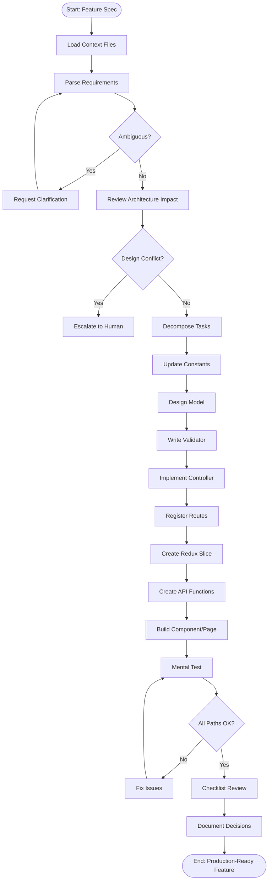

# AI_WORKFLOW.md — AI Execution Workflow Definitions

## Overview
This file defines all operational workflows for AI agents in this system. Each workflow follows the agent-workflow-creator skill format: decomposed steps, named I/O, tool assignments, failure handling, and YAML specs.

---

## Workflow 1: New Feature Implementation

### Summary
Takes a feature specification and delivers production-ready code (backend + frontend) following MERN stack standards. Involves planning, implementation, validation, and documentation.

### Step-by-Step Table

| Step # | Step Name | Description | Tool | Input | Output | On Failure |
|--------|-----------|-------------|------|-------|--------|------------|
| 1 | Context Load | Load OBJECTIVE, STACK, ARCHITECTURE, CODING_STANDARDS | file_read | session_start | context_bundle | Retry once; halt on 2nd failure |
| 2 | Requirement Parse | Extract feature spec, constraints, acceptance criteria | llm_completion | feature_spec | parsed_requirements | Request clarification from human |
| 3 | Architecture Review | Verify feature fits system design; identify affected files | file_read | ARCHITECTURE.md | impact_map | Escalate if design conflict found |
| 4 | Task Decomposition | Break feature into atomic implementation tasks | llm_completion | parsed_requirements | task_list | Reduce granularity until atomic |
| 5 | Constants Check | Identify if new error/response codes needed | file_read | constants.js | constants_diff | Add new codes before proceeding |
| 6 | Model Design | Define/update Mongoose schema (UUID _id, isDeleted, timestamps) | file_write | constants_diff | model_file | Fix schema errors; retry |
| 7 | Validator Creation | Write express-validator rules for new endpoints | file_write | parsed_requirements | validator_file | Fix validation logic; retry |
| 8 | Controller Implementation | Write controller with JSDoc, try/catch, ApiResponse pattern | file_write | model_file + validator_file | controller_file | Fix and retry; escalate if blocked |
| 9 | Route Registration | Wire route chain: auth → guard → validator → controller | file_write | controller_file | routes_updated | Fix import errors; retry |
| 10 | Frontend Slice | Create Redux Toolkit slice with loading/error/clearError | file_write | API_spec | slice_file | Fix RTK errors; retry |
| 11 | API Function | Create axiosInstance-based API function file | file_write | API_spec | api_file | Fix Axios config; retry |
| 12 | Component/Page | Create React component or page consuming the slice | file_write | slice_file + api_file | component_file | Fix JSX/hook errors; retry |
| 13 | Mental Test | Verify happy path + all error paths mentally | llm_completion | all_modified_files | test_results | Fix identified issues; re-verify |
| 14 | Checklist Review | Verify against CODING_STANDARDS + SECURITY checklists | file_read | all_modified_files | checklist_results | Fix violations before delivery |
| 15 | Documentation | Update DECISIONS.md, TASKS.md, LEARNINGS.md | file_write | session_outputs | documentation | Log failure; still deliver code |

### Mermaid Flowchart


---

## Workflow 2: Bug Investigation & Fix

### Summary
Systematic debugging workflow following Trace-Solve-Clean from debug-expressjs-error, debug-reactjs-error, and debug-mern-stack-error skills.

### Step-by-Step Table

| Step # | Step Name | Description | Tool | Input | Output | On Failure |
|--------|-----------|-------------|------|-------|--------|------------|
| 1 | Error Intake | Capture full error message, stack trace, context | file_read + log_analysis | error_report | structured_error |  Request more context from human |
| 2 | Pattern Match | Check FAILURES.md for known similar errors | file_read | structured_error | pattern_match | Proceed as new bug if no match |
| 3 | Scope Isolation | Identify which layer (Express / React / DB / network) failed | llm_completion | structured_error | error_scope | Cross-check both layers |
| 4 | Instrumentation | Add // [DEBUG] prefixed logs at key entry/exit points | file_write | error_scope | instrumented_files | Use minimal viable instrumentation |
| 5 | Trace Execution | Follow data flow from entry to failure point | code_execution | instrumented_files | trace_output | Add deeper instrumentation; retry |
| 6 | Root Cause ID | Identify the exact line, condition, or missing handling | llm_completion | trace_output | root_cause | Escalate if root cause unclear |
| 7 | Fix Design | Plan the minimal correct fix | llm_completion | root_cause | fix_plan | Consider side effects carefully |
| 8 | Fix Implementation | Apply the fix | file_write | fix_plan | fixed_files | Rollback; try alternative approach |
| 9 | Verify Fix | Confirm the original error no longer occurs | code_execution | fixed_files | verification_result | Return to step 6 |
| 10 | Cleanup | Remove ALL // [DEBUG] logs | file_write | instrumented_files | clean_files | Automated scan; remove manually |
| 11 | Document | Write to FAILURES.md: error, root cause, fix | file_write | root_cause + fix_plan | FAILURES.md updated | Log summary; continue |

---

## Workflow 3: Agent Workflow Design

### Summary
Designs a new automation workflow following the agent-workflow-creator skill. Produces step tables, Mermaid diagram, YAML spec, and execution checklist.

### Step-by-Step Table

| Step # | Step Name | Description | Tool | Input | Output | On Failure |
|--------|-----------|-------------|------|-------|--------|------------|
| 1 | Goal Extraction | Extract objective, inputs, outputs, constraints, failure tolerance | llm_completion | user_request | workflow_brief | Ask targeted questions |
| 2 | Task Decomposition | Break goal into atomic steps with clear boundaries | llm_completion | workflow_brief | step_list | Reduce scope; increase granularity |
| 3 | Tool Assignment | Assign exact tool/capability to each step | llm_completion | step_list | step_list_with_tools | Fall back to llm_completion for ambiguous steps |
| 4 | Control Flow | Define success/failure/ambiguity paths for each step | llm_completion | step_list_with_tools | control_flow_map | Default to human escalation for unknown paths |
| 5 | Mermaid Diagram | Generate visual flowchart matching the step table exactly | llm_completion | step_list_with_tools | mermaid_diagram | Simplify diagram; maintain accuracy |
| 6 | YAML Spec | Produce machine-readable YAML workflow definition | llm_completion | control_flow_map | workflow_yaml | Validate YAML syntax; fix errors |
| 7 | Error Plan | Define failure class → detection → recovery → escalation | llm_completion | workflow_yaml | error_plan | Use standard failure classes |
| 8 | Checklist | Generate pre-flight execution checklist | llm_completion | workflow_yaml + error_plan | checklist | Use standard checklist template |
| 9 | Quality Review | Verify all steps have named I/O, all branches labeled | llm_completion | all_outputs | review_results | Fix gaps before delivery |
| 10 | Save Workflow | Write to AI_WORKFLOW.md or new dedicated workflow file | file_write | all_outputs | workflow_document | Log in KNOWLEDGE_BASE.md instead |

---

## Workflow 4: Prompt Engineering

### Summary
Creates or refines AI prompts using CO-STAR framework + Chain of Thought + Few-Shot techniques.

### Step-by-Step Table

| Step # | Step Name | Description | Tool | Input | Output | On Failure |
|--------|-----------|-------------|------|-------|--------|------------|
| 1 | Intent Analysis | Identify CO-STAR components from user request | llm_completion | user_request | co_star_map | Ask clarifying questions |
| 2 | Technique Selection | Choose CoT / Few-Shot / Delimiters / Role Assignment as needed | llm_completion | co_star_map | technique_plan | Default to CoT + Role Assignment |
| 3 | Prompt Draft | Write initial prompt using template | llm_completion | co_star_map + technique_plan | draft_prompt | Try simpler structure |
| 4 | Test Run | Simulate model response to evaluate prompt quality | llm_completion | draft_prompt | simulated_response | Refine prompt; re-test |
| 5 | Gap Analysis | Identify missing context, ambiguous instructions, format issues | llm_completion | simulated_response | gap_list | Apply CO-STAR to fill gaps |
| 6 | Refinement | Improve prompt based on gap analysis | llm_completion | draft_prompt + gap_list | refined_prompt | Iterate until gaps resolved |
| 7 | Delivery | Present final prompt with explanation of design choices | llm_completion | refined_prompt | final_prompt_doc | Document known limitations |

---

## Workflow YAML Registry

```yaml
workflows:
  - id: feature_implementation
    name: New Feature Implementation
    version: "1.0"
    trigger: "user requests new feature or API endpoint"
    steps: 15
    typical_duration: "30-60 minutes"
    agents: [orchestrator, mern_developer, qa_validator]

  - id: bug_fix
    name: Bug Investigation and Fix
    version: "1.0"
    trigger: "error, exception, or unexpected behavior reported"
    steps: 11
    typical_duration: "15-45 minutes"
    agents: [debugger, mern_developer]

  - id: workflow_design
    name: Agent Workflow Design
    version: "1.0"
    trigger: "user requests automation, pipeline, or agent workflow"
    steps: 10
    typical_duration: "20-40 minutes"
    agents: [workflow_designer, orchestrator]

  - id: prompt_engineering
    name: Prompt Engineering
    version: "1.0"
    trigger: "user requests prompt creation or improvement"
    steps: 7
    typical_duration: "10-20 minutes"
    agents: [prompt_engineer]
```
