# Agent Workflow Creator

A comprehensive skill for generating complete, production-ready agent workflows. Given any task, goal, or domain, this skill produces structured workflows that AI agents can execute reliably — with clear steps, decision logic, tool assignments, error handling, and output definitions.

---

## Core Philosophy

A great agent workflow is more than a list of steps. It is:
- **Decomposed** — every ambiguous task broken into atomic, executable actions
- **Deterministic at the edges** — clear entry and exit conditions at every node
- **Tool-aware** — each step names the exact tool, API, or capability needed
- **Failure-safe** — every step has a fallback or error path defined
- **Observable** — outputs at each step are named, typed, and passed forward explicitly
- **Role-assigned** — in multi-agent systems, every step says WHO does it

Think of yourself as both a systems architect and an AI director: you're building a machine that runs reliably without human intervention, but also a script that any capable agent can follow.

---

## Workflow Generation Process

When the user gives you a task to turn into an agent workflow, follow this process:

### Step 1 — Understand the Goal
Before designing anything, extract:
- **Objective**: What is the final deliverable or outcome?
- **Inputs**: What data, files, or context does the workflow receive?
- **Constraints**: Speed, cost, tool availability, privacy, etc.
- **Failure tolerance**: Is this best-effort or mission-critical?
- **Agent type**: Single agent, multi-agent, human-in-the-loop, or fully autonomous?

If the user hasn't provided enough information, ask targeted questions before proceeding. Don't guess on objectives.

### Step 2 — Decompose the Task
Break the goal into a directed graph of steps:
- Each step = one atomic action (fetch, parse, decide, transform, call API, write file, etc.)
- Identify sequential dependencies and parallel opportunities
- Mark decision points (branching logic) explicitly
- Identify loops (retry, poll, iterate) vs. one-shot steps

Use the **Step Schema** (see `references/step-schema.md`) for structuring each node.

### Step 3 — Assign Tools and Agents
For every step, specify:
- **Tool**: The exact capability needed (web_search, code_execution, file_read, API call, LLM completion, etc.)
- **Agent role** (if multi-agent): Orchestrator, Researcher, Writer, Validator, etc.
- **Input contract**: What does this step receive?
- **Output contract**: What does it produce and pass forward?

### Step 4 — Add Control Flow
Define:
- **Entry condition**: When does this step start?
- **Exit condition**: When is it done?
- **On success**: Where does the flow go next?
- **On failure**: Retry? Fallback step? Alert human? Abort?
- **On ambiguity**: Does this step need a human checkpoint?

### Step 5 — Generate Outputs
Produce all of the following (see individual sections below):
1. **Workflow Summary** — plain-English description
2. **Step-by-Step Table** — structured table of all steps
3. **Mermaid Flowchart** — visual diagram of the workflow
4. **Agent Roles Card** — who does what
5. **Tool Manifest** — all tools and capabilities required
6. **Error Handling Plan** — what can go wrong and how it's handled
7. **YAML Workflow Definition** — machine-readable workflow spec
8. **Execution Checklist** — pre-flight checks before running

---

## Output Formats

### 1. Workflow Summary
A 3–5 sentence plain-English description:
- What the workflow does
- What it takes as input
- What it produces as output
- How long it typically takes / how many steps

### 2. Step-by-Step Table
Always output a table with these columns:

| Step # | Step Name | Description | Tool / Capability | Input | Output | On Failure |
|--------|-----------|-------------|-------------------|-------|--------|------------|

Every row must be filled completely. "TBD" is not acceptable.

### 3. Mermaid Flowchart
Always generate a Mermaid diagram. Use this format:

```mermaid
flowchart TD
    A([Start: <input>]) --> B[Step: <name>]
    B --> C{Decision: <condition>}
    C -->|Yes| D[Step: <name>]
    C -->|No| E[Step: <name>]
    D --> F([End: <output>])
    E --> F
```



Node shape guide:
- `([text])` — Start / End (stadium)
- `[text]` — Action step (rectangle)
- `{text}` — Decision point (diamond)
- `[(text)]` — Data store / file (cylinder)
- `((text))` — Sub-workflow / agent call (circle)

Color-code by agent role when multi-agent (use `style` or `classDef`).

### 4. Agent Roles Card
For multi-agent workflows:

| Role | Responsibility | Steps Owned | Tools Available |
|------|----------------|-------------|-----------------|

For single-agent workflows, describe the agent's persona, capability profile, and any sub-roles it plays.

### 5. Tool Manifest
List every tool the workflow requires:

| Tool Name | Type | Steps Used In | Required Credentials / Config |
|-----------|------|---------------|-------------------------------|

Types: `web_search`, `code_execution`, `file_io`, `api_call`, `llm_completion`, `database`, `human_input`, `memory`, `vector_search`, `notification`

### 6. Error Handling Plan
For each major failure class, define:

| Failure Type | Affected Steps | Detection Method | Recovery Strategy | Escalation |
|--------------|----------------|------------------|-------------------|------------|

Standard failure classes to always consider:
- Tool unavailable / rate limited
- Malformed / unexpected input
- LLM hallucination or low-confidence output
- Step timeout
- Downstream dependency failure
- Data quality / validation failure

### 7. YAML Workflow Definition
Always produce a machine-readable YAML spec. Read `references/yaml-schema.md` for the full schema. Abbreviated example:

```yaml
workflow:
  name: my-workflow
  version: "1.0"
  description: "What this workflow does"
  inputs:
    - name: query
      type: string
      required: true
  outputs:
    - name: report
      type: file
  steps:
    - id: step_01
      name: Fetch Data
      tool: web_search
      input: "{{inputs.query}}"
      output: raw_results
      on_failure:
        strategy: retry
        max_attempts: 3
      next: step_02
```

### 8. Execution Checklist
Pre-flight items to verify before running the workflow:

- [ ] All required tools are available and authenticated
- [ ] Input data format matches the workflow's input schema
- [ ] Output destinations are writable
- [ ] Rate limits and quotas checked for all APIs used
- [ ] Error notification channels configured
- [ ] Logging / observability enabled
- [ ] Test run on sample input completed

---

## Workflow Patterns Library

When designing, identify which pattern(s) apply and apply them correctly. Read `references/patterns.md` for full pattern details with examples.

**Quick Reference:**
| Pattern | When to Use |
|---------|-------------|
| Sequential Chain | Steps must happen in strict order |
| Map-Reduce | Apply same operation to many items, then aggregate |
| Fan-Out / Fan-In | Parallel execution, then merge results |
| ReAct Loop | Agent reasons and acts iteratively until goal met |
| Critic-Refine | One agent produces, another critiques, repeat |
| Human-in-the-Loop | Insert approval or input checkpoint |
| Retrieval-Augmented | Fetch context before generating |
| Event-Driven | Workflow triggered by external event or signal |
| Recursive Decomposer | Break task into subtasks recursively |
| Supervisor-Worker | Orchestrator delegates to specialist agents |

---

## Quality Checklist (Self-Review Before Presenting)

Before outputting the workflow, verify:

- [ ] Every step has a named input and named output
- [ ] No step is ambiguous ("do research" → specify what kind, how, with what tool)
- [ ] Every decision point has all branches labeled
- [ ] All failure paths lead somewhere (retry, fallback, or human escalation)
- [ ] The Mermaid diagram matches the step table exactly
- [ ] The YAML is valid and complete
- [ ] Tools in the manifest match tools referenced in steps
- [ ] The workflow solves the stated objective end-to-end

---

## Domain-Specific Guidance

For specialized domains, read the relevant reference file before designing:

- **Research / knowledge workflows** → `references/domains/research.md`
- **Data processing / ETL workflows** → `references/domains/data-pipeline.md`
- **Content creation workflows** → `references/domains/content.md`
- **Customer support / triage workflows** → `references/domains/support.md`
- **Code generation / review workflows** → `references/domains/coding.md`
- **Document processing workflows** → `references/domains/documents.md`

---

## Scripts

Use these scripts to accelerate workflow generation:

- `scripts/generate_workflow.py` — CLI tool to scaffold a YAML workflow from a task description
- `scripts/validate_workflow.py` — Validates a YAML workflow file against the schema
- `scripts/render_mermaid.py` — Converts a YAML workflow to a Mermaid diagram string
- `scripts/export_workflow.py` — Exports a workflow to multiple formats (JSON, YAML, Markdown)

Run any script with `--help` for full usage.

---

## Example Workflows

For inspiration and templates, see:
- `references/examples/research-report-workflow.yaml`
- `references/examples/customer-support-triage.yaml`
- `references/examples/data-etl-pipeline.yaml`
- `references/examples/content-creation-workflow.yaml`

---

## Reminders

- **Be specific.** "Search the web" is not a step. "Use web_search tool with query `{{user_query}}` and return top 5 results as `raw_results`" is a step.
- **Name everything.** Every input variable, output variable, and intermediate state should have a name. Anonymous data is a bug waiting to happen.
- **Parallel when possible.** If steps are independent, flag them as parallelizable — it matters for performance.
- **Don't skip error handling.** A workflow without error handling is a proof of concept, not a production system.
- **Match the user's level.** If they said "I'm new to agents", explain concepts as you go. If they said "give me the YAML", skip the hand-holding.
