# [Workflow Name]

> **Generated by:** agent-workflow-creator  
> **Date:** [YYYY-MM-DD]  
> **Version:** 1.0  
> **Pattern:** [Sequential Chain | Map-Reduce | Fan-Out/Fan-In | ReAct Loop | Critic-Refine | Human-in-the-Loop | etc.]  
> **Agent Type:** [Single Agent | Multi-Agent | Human-in-the-Loop | Fully Autonomous]

---

## Workflow Summary

[3–5 sentences describing what the workflow does, what it takes as input, what it produces as output, and roughly how many steps it involves.]

---

## Step-by-Step Table

| Step # | Step Name | Description | Tool / Capability | Input | Output | On Failure |
|--------|-----------|-------------|-------------------|-------|--------|------------|
| 1 | | | | | | |
| 2 | | | | | | |
| 3 | | | | | | |

---

## Mermaid Flowchart

```mermaid
flowchart TD
    A([Start: <input>]) --> B[Step 1: <name>]
    B --> C{Decision: <condition>}
    C -->|Yes| D[Step 2a: <name>]
    C -->|No| E[Step 2b: <name>]
    D --> F([End: <output>])
    E --> F
```



---

## Agent Roles

| Role | Responsibility | Steps Owned | Tools Available |
|------|----------------|-------------|-----------------|
| | | | |

*For single-agent workflows: describe the agent's persona and capability profile here.*

---

## Tool Manifest

| Tool Name | Type | Steps Used In | Required Credentials / Config |
|-----------|------|---------------|-------------------------------|
| | | | |

**Tool types:** `web_search`, `code_execution`, `file_io`, `api_call`, `llm_completion`, `database`, `human_input`, `memory`, `vector_search`, `notification`

---

## Error Handling Plan

| Failure Type | Affected Steps | Detection Method | Recovery Strategy | Escalation |
|--------------|----------------|------------------|-------------------|------------|
| Tool unavailable / rate limited | | | | |
| Malformed / unexpected input | | | | |
| LLM hallucination or low-confidence output | | | | |
| Step timeout | | | | |
| Downstream dependency failure | | | | |
| Data quality / validation failure | | | | |

---

## YAML Workflow Definition

```yaml
workflow:
  name: my-workflow
  version: "1.0"
  description: ""
  pattern: sequential-chain
  agent_type: single-agent

  inputs:
    - name: input_name
      type: string
      description: ""
      required: true

  outputs:
    - name: output_name
      type: file
      format: markdown
      description: ""

  steps:
    - id: step_01
      name: Step Name
      description: ""
      tool: llm_completion
      input: {}
      output: result_name
      on_failure:
        strategy: retry
        max_attempts: 3
      next: step_02

    - id: step_02
      name: Step Name
      description: ""
      tool: file_io
      input: {}
      output: result_name
      on_failure:
        strategy: abort
      next: END
```

---

## Execution Checklist

- [ ] All required tools are available and authenticated
- [ ] Input data format matches the workflow's input schema
- [ ] Output destinations are writable
- [ ] Rate limits and quotas checked for all APIs used
- [ ] Error notification channels configured
- [ ] Logging / observability enabled
- [ ] Test run on sample input completed

---

## Notes & Assumptions

[Any important assumptions made during design, open questions, or future enhancements to consider.]
