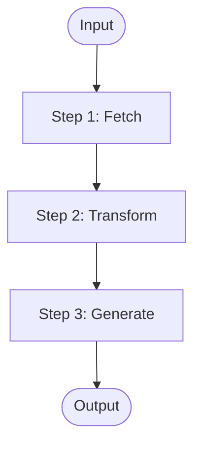
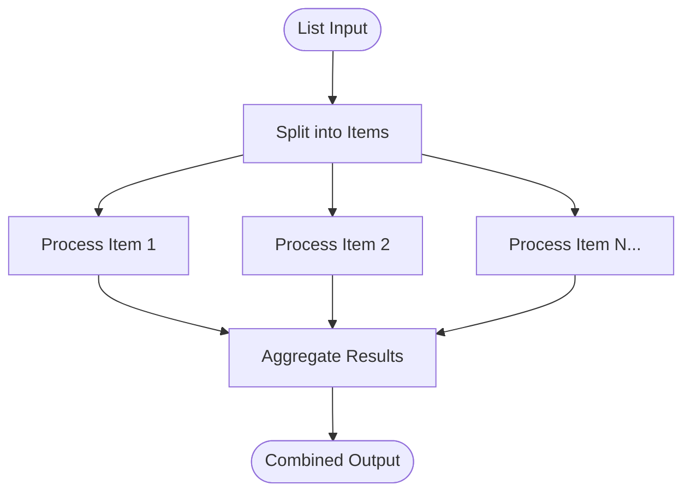
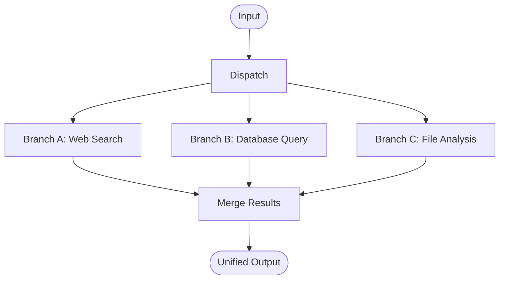
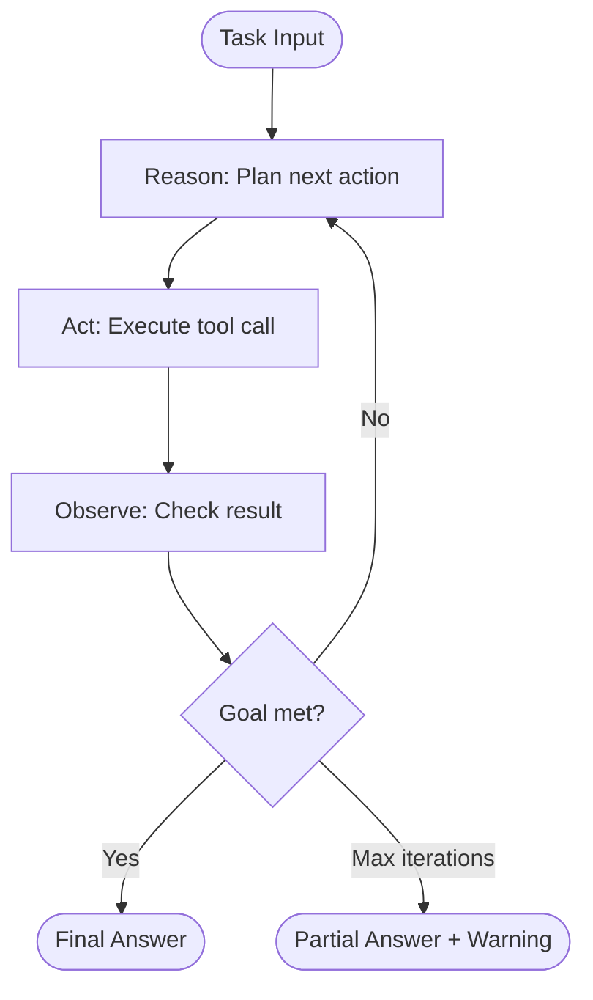
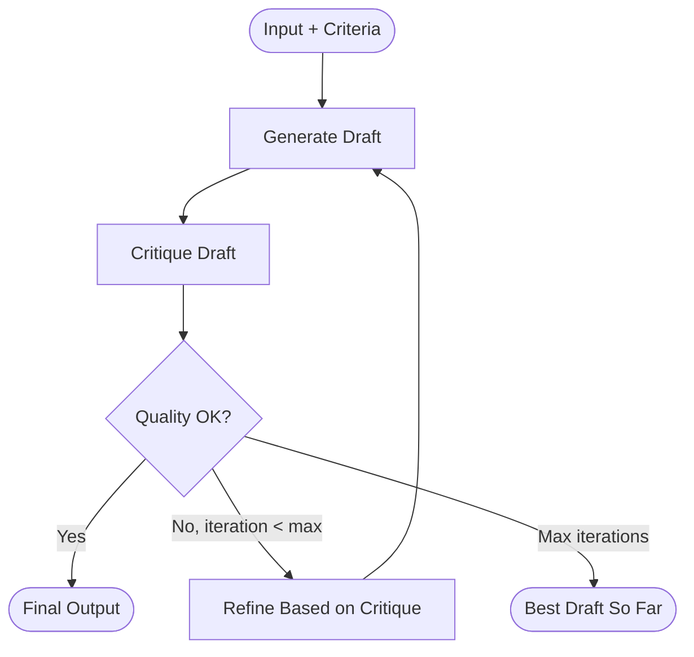
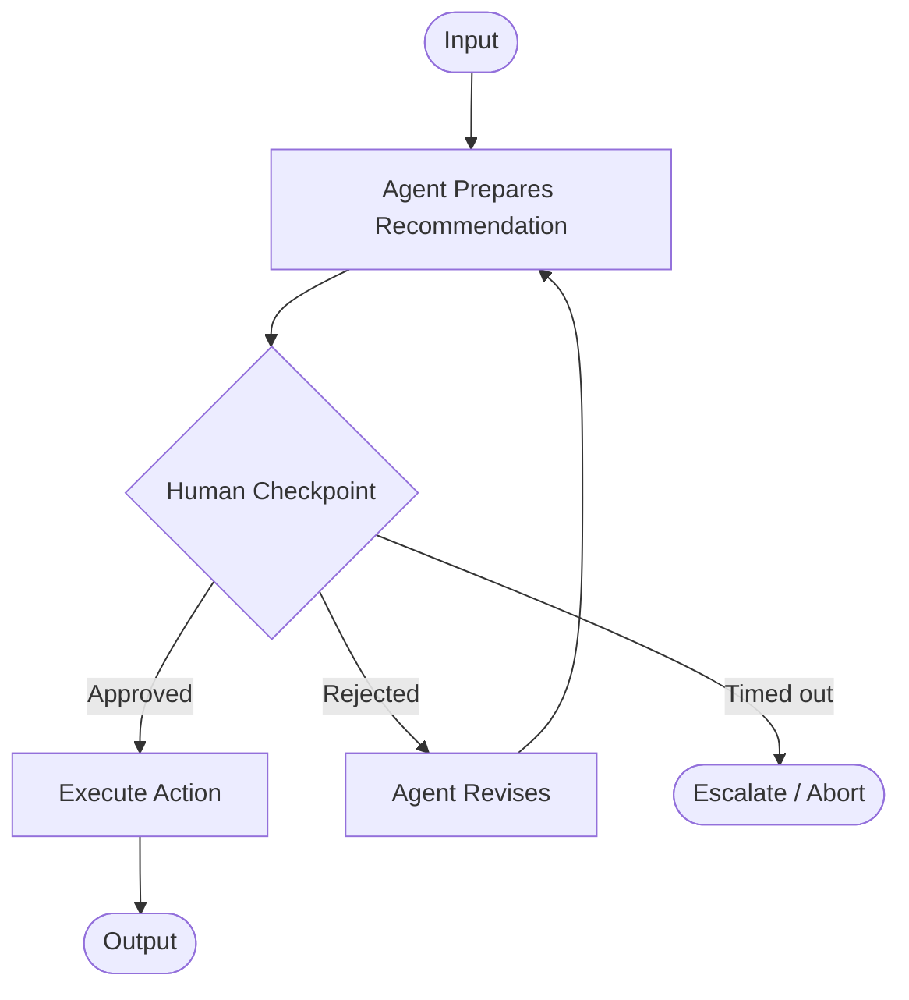
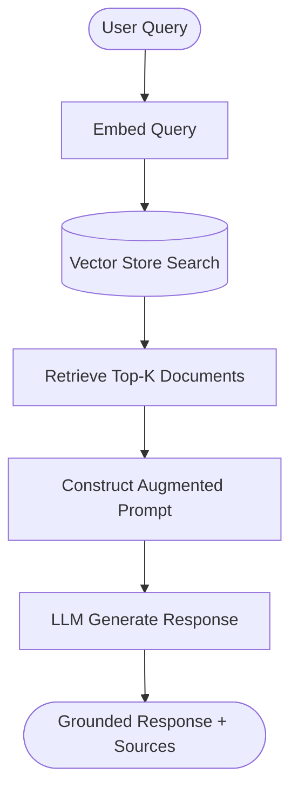
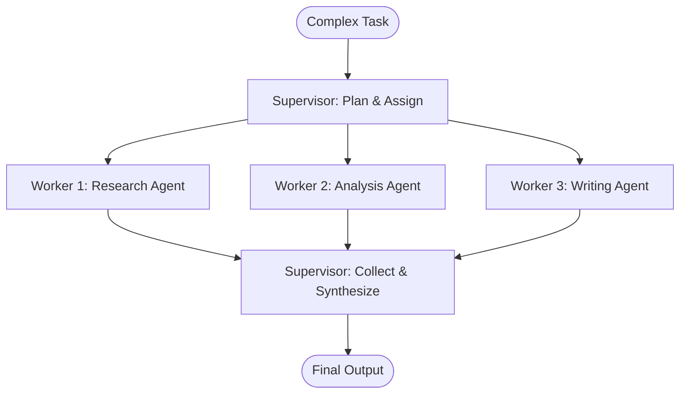
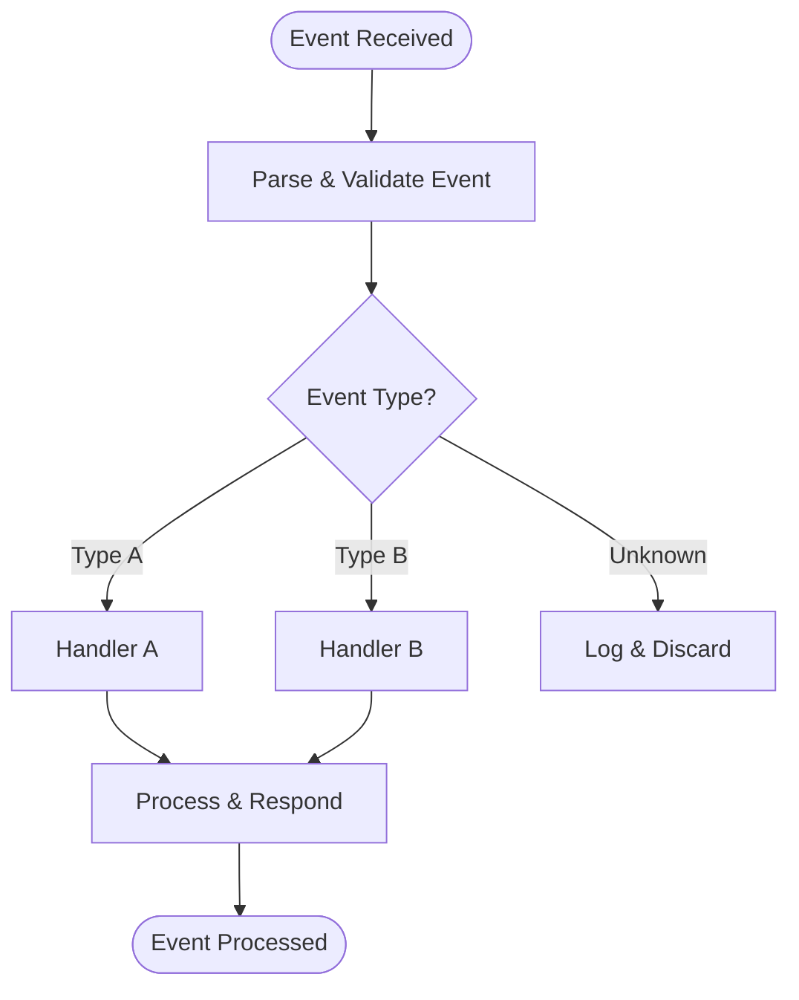

# Workflow Patterns Library

Canonical patterns for agent workflows. Each pattern includes: when to use it, how it works, a Mermaid diagram, and a YAML skeleton.

---

## 1. Sequential Chain

**When to use:** Steps must happen in strict order, each output feeding the next.

**How it works:** Linear pipeline — step A → step B → step C → output.



**YAML skeleton:**
```yaml
steps:
  - id: step_01
    name: Fetch
    on_success:
      next: step_02
  - id: step_02
    name: Transform
    on_success:
      next: step_03
  - id: step_03
    name: Generate
    # terminal step — no next
```

**Best for:** Document processing, data transformation, linear text generation.

---

## 2. Map-Reduce

**When to use:** Apply the same operation to many items, then aggregate results.

**How it works:** Split input into items → process each in parallel (map) → combine results (reduce).



**YAML skeleton:**
```yaml
steps:
  - id: step_01_split
    name: Split Input
    tool: code_execution
    output:
      name: item_list
      type: list
    on_success:
      next: step_02_map

  - id: step_02_map
    name: Process Each Item
    tool: llm_completion
    parallel: true
    input:
      from: step_01_split.item_list
      field: each_item
    output:
      name: processed_items
      type: list
    on_success:
      next: step_03_reduce

  - id: step_03_reduce
    name: Aggregate Results
    tool: llm_completion
    input:
      from: step_02_map.processed_items
```

**Best for:** Batch processing documents, analyzing multiple sources, multi-query search.

---

## 3. Fan-Out / Fan-In

**When to use:** Execute multiple independent tasks in parallel, then merge.

**How it works:** One trigger → multiple parallel branches → merge when all complete.



**YAML skeleton:**
```yaml
steps:
  - id: step_01_dispatch
    name: Dispatch
    on_success:
      next: [step_02a, step_02b, step_02c]  # parallel fork

  - id: step_02a
    name: Branch A
    parallel: true

  - id: step_02b
    name: Branch B
    parallel: true

  - id: step_02c
    name: Branch C
    parallel: true

  - id: step_03_merge
    name: Merge Results
    input:
      from: [step_02a.output, step_02b.output, step_02c.output]
    # waits for all parallel branches
```

**Best for:** Multi-source research, simultaneous API calls, competitive analysis.

---

## 4. ReAct Loop (Reason + Act)

**When to use:** Agent must iteratively reason and act until a goal condition is met.

**How it works:** Think → Act → Observe → Think again → repeat until done or max iterations.



**YAML skeleton:**
```yaml
steps:
  - id: step_01_reason
    name: Reason
    tool: llm_completion
    prompt: |
      Current task: {{inputs.task}}
      Previous actions: {{memory.action_history}}
      What is the best next action to take?
    output:
      name: next_action
      type: json
    on_success:
      next: step_02_act

  - id: step_02_act
    name: Act
    tool: "{{step_01_reason.next_action.tool}}"
    input:
      from: step_01_reason.next_action
      field: parameters
    output:
      name: action_result
    on_success:
      next: step_03_observe

  - id: step_03_observe
    name: Observe and Check
    tool: code_execution
    branches:
      - condition: "goal_met == true OR iteration_count >= 10"
        next: step_04_finalize
      - condition: "default"
        next: step_01_reason   # loop back
```

**Best for:** Open-ended research, multi-step problem solving, autonomous task completion.

---

## 5. Critic-Refine (Generate-Evaluate-Improve)

**When to use:** Quality matters — generate a draft, then critique and improve it.

**How it works:** Generator produces output → Critic evaluates → if quality threshold met, done; else refine.



**YAML skeleton:**
```yaml
steps:
  - id: step_01_generate
    name: Generate Draft
    tool: llm_completion
    prompt: "Generate: {{inputs.task}}"
    output:
      name: draft
    on_success:
      next: step_02_critique

  - id: step_02_critique
    name: Critique Draft
    tool: llm_structured
    prompt: |
      Evaluate this draft against these criteria: {{inputs.quality_criteria}}
      Draft: {{step_01_generate.draft}}
      Return JSON: { "score": 0-10, "passed": bool, "feedback": string }
    output:
      name: critique
      type: json
    branches:
      - condition: "critique.passed == true OR iteration >= 3"
        next: step_03_finalize
      - condition: "default"
        next: step_01_generate  # loop with feedback in context
```

**Best for:** Writing tasks, code generation, any output where quality matters.

---

## 6. Human-in-the-Loop

**When to use:** Some decisions require human judgment, approval, or input.

**How it works:** Workflow pauses at a checkpoint and waits for human response before continuing.



**YAML skeleton:**
```yaml
steps:
  - id: step_01_prepare
    name: Prepare for Human Review
    on_success:
      next: step_02_checkpoint

  - id: step_02_checkpoint
    name: Human Approval
    tool: human_input
    prompt: "Please review: {{step_01_prepare.recommendation}}. Approve, reject, or modify?"
    output:
      name: human_decision
      type: json
    timeout_seconds: 86400    # 24 hours
    branches:
      - condition: "human_decision.action == 'approve'"
        next: step_03_execute
      - condition: "human_decision.action == 'reject'"
        next: step_01_prepare
    on_failure:
      strategy: abort
      alert: email_ops_team
```

**Best for:** Financial decisions, content publishing, irreversible actions, compliance workflows.

---

## 7. Retrieval-Augmented Generation (RAG)

**When to use:** Agent needs context from a knowledge base before generating.

**How it works:** Retrieve relevant documents → augment the prompt → generate informed response.



**YAML skeleton:**
```yaml
steps:
  - id: step_01_embed
    name: Embed Query
    tool: vector_search
    input:
      from: inputs
      field: query
    output:
      name: query_embedding
    on_success:
      next: step_02_retrieve

  - id: step_02_retrieve
    name: Retrieve Relevant Documents
    tool: vector_search
    tool_config:
      top_k: 5
      score_threshold: 0.7
    input:
      from: step_01_embed.query_embedding
    output:
      name: retrieved_docs
      type: list
    on_success:
      next: step_03_generate

  - id: step_03_generate
    name: Generate Grounded Response
    tool: llm_completion
    prompt: |
      Using ONLY the following context, answer: {{inputs.query}}
      Context: {{step_02_retrieve.retrieved_docs}}
      If the answer is not in the context, say so.
    output:
      name: response
```

**Best for:** Customer support bots, internal knowledge bases, document Q&A.

---

## 8. Supervisor-Worker (Orchestrator-Subagent)

**When to use:** Complex task requiring specialist agents coordinated by a planner.

**How it works:** Supervisor breaks task into subtasks → assigns to specialist workers → collects results → synthesizes.



**YAML skeleton:**
```yaml
agents:
  - id: supervisor
    name: Orchestrator
    tools: [llm_completion, agent_handoff]
  - id: researcher
    name: Research Agent
    tools: [web_search, web_fetch]
  - id: analyst
    name: Analysis Agent
    tools: [code_execution, llm_structured]
  - id: writer
    name: Writing Agent
    tools: [llm_completion, file_write]

steps:
  - id: step_01_plan
    agent: supervisor
    name: Decompose Task
    tool: llm_completion
    output:
      name: task_assignments
      type: json

  - id: step_02_research
    agent: researcher
    parallel: true
    tool: web_search
    input:
      from: step_01_plan.task_assignments
      field: research_tasks

  - id: step_02_analyze
    agent: analyst
    parallel: true
    tool: code_execution
    input:
      from: step_01_plan.task_assignments
      field: analysis_tasks

  - id: step_03_synthesize
    agent: supervisor
    name: Synthesize Results
    input:
      from: [step_02_research.output, step_02_analyze.output]
    on_success:
      next: step_04_write

  - id: step_04_write
    agent: writer
    tool: llm_completion
```

**Best for:** Research projects, complex report generation, multi-domain analysis.

---

## 9. Event-Driven Workflow

**When to use:** Workflow triggered by an external event, not a direct user request.

**How it works:** Listen for event → validate event → route to appropriate handler → process → respond.



**Best for:** Webhook handlers, real-time monitoring, alert systems, chatbots.

---

## Pattern Combination Guide

Patterns compose. Common combinations:

| Combination | Use Case |
|-------------|----------|
| ReAct + RAG | Research agent with memory |
| Map-Reduce + Critic-Refine | Batch content generation with quality control |
| Supervisor-Worker + Fan-In | Complex research with multiple specialists |
| Sequential + Human-in-Loop | Approval workflows |
| Event-Driven + ReAct | Real-time autonomous agent |
